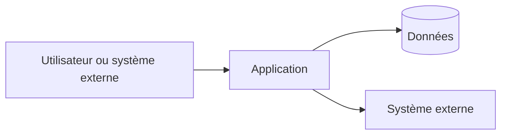

# Architecture technique

## Décisions et contraintes structurantes

Non applicable pour un jeu local en terminal

## Composants et responsabilités

| Composant | Responsabilité | Entrées | Sorties | Dépendances | Observabilité |
| --- | --- | --- | --- | --- | --- |
| Non applicable pour un jeu local en terminal | Non applicable pour un jeu local en terminal | Non applicable pour un jeu local en terminal | Non applicable pour un jeu local en terminal | Non applicable pour un jeu local en terminal | Non applicable pour un jeu local en terminal |

## Diagramme de contexte et conteneurs

Non applicable pour un jeu local en terminal

## Flux critiques et résilience

Non applicable pour un jeu local en terminal

## Qualité technique

Non applicable pour un jeu local en terminal
