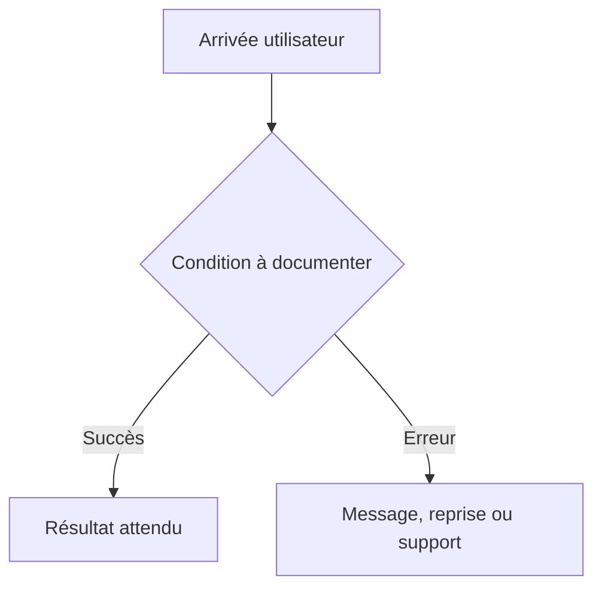

# Parcours utilisateur

## Inventaire des parcours

| ID | Déclencheur | Acteur | Résultat attendu | Échecs et reprises | Stories liées |
| --- | --- | --- | --- | --- | --- |
| FLOW-001 | Non applicable pour un jeu local en terminal | Non applicable pour un jeu local en terminal | Non applicable pour un jeu local en terminal | Non applicable pour un jeu local en terminal | Non applicable pour un jeu local en terminal |

## Diagramme des parcours critiques

Non applicable pour un jeu local en terminal

## Détails par parcours

### FLOW-001

- Préconditions : Non applicable pour un jeu local en terminal
- Étapes nominales : Non applicable pour un jeu local en terminal
- Validations et erreurs : Non applicable pour un jeu local en terminal
- Annulation, reprise et persistance : Non applicable pour un jeu local en terminal
- Critères de sortie : Non applicable pour un jeu local en terminal
